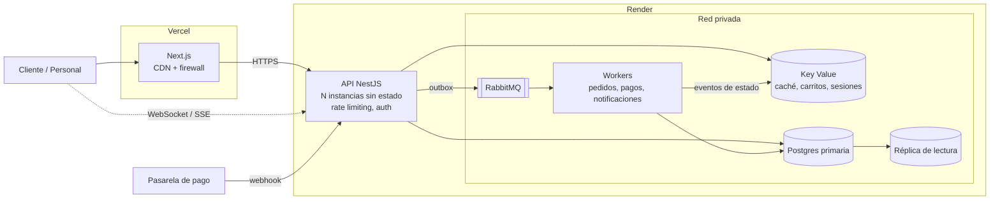
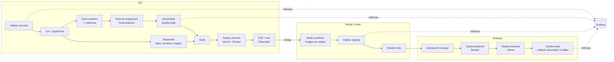

# Proyecto Cafetería

## 1. Descripción

Aplicación web para gestionar una cafetería online: los clientes consultan el menú, arman un carrito, pagan y siguen su pedido; el personal administra menús, promociones y pedidos.

### Actores

| Actor | Qué hace |
|---|---|
| Cliente | Se registra, navega el menú, gestiona su carrito, paga y consulta sus pedidos y datos personales. |
| Personal de cafetería | Recibe y cambia el estado de los pedidos, confirma pagos en efectivo y transferencias. |
| Administrador | Gestiona menús, productos, precios, promociones, usuarios del personal y reportes. |

## 2. Requisitos funcionales

### RF-01 Gestión de clientes
- Registro, inicio de sesión y recuperación de contraseña.
- El cliente puede ver, editar, exportar y eliminar sus datos personales (ver RNF-04).
- Historial de pedidos por cliente.

### RF-02 Menú dinámico
- El administrador crea, edita, publica y retira menús, categorías y productos (nombre, descripción, precio, imagen con texto alternativo, alérgenos, disponibilidad).
- Los cambios se reflejan en la tienda sin desplegar código.
- Los menús tienen **versiones**: un pedido guarda el precio y la descripción vigentes al comprar, aunque el menú cambie después.
- Disponibilidad por horario (p. ej. menú de desayuno de 07:00 a 11:00) y por existencias.

### RF-03 Carrito de compras
- Un carrito activo por cliente, persistente entre sesiones y dispositivos.
- Agregar, quitar y cambiar cantidades de varios productos.
- El carrito muestra el precio con descuentos aplicados y avisa si un producto dejó de estar disponible o cambió de precio.

### RF-04 Pedidos
- Al confirmar el carrito se crea un pedido con estados: `pendiente_pago → pagado → en_preparacion → listo → entregado`, más `cancelado`.
- El cliente ve el estado de su pedido en tiempo (casi) real.
- El personal ve una cola de pedidos y cambia su estado.
- Los pedidos se **retiran en la cafetería** con un código de retiro; la entrega a domicilio queda fuera de la primera versión.

### RF-05 Formas de pago
- **Tarjeta de crédito:** mediante una pasarela de pago externa con tokenización; el sistema nunca recibe ni almacena el número de tarjeta.
- **Transferencia:** el pedido queda pendiente hasta que el personal (o una conciliación bancaria) confirma el pago.
- **Efectivo:** el pago se registra al entregar el pedido.
- La confirmación de pagos es idempotente: reintentos o notificaciones duplicadas de la pasarela no cobran ni confirman dos veces.

### RF-06 Promociones y descuentos
- El administrador define promociones con: tipo (porcentaje, monto fijo, 2x1, combo), alcance (producto, categoría o menú), **ventana de vigencia** (fecha/hora de inicio y fin, p. ej. Navidad, Día de la Madre) y condiciones opcionales (monto mínimo, cupón).
- Reglas de combinación explícitas: prioridad y si una promoción es acumulable o no.
- El precio final siempre lo calcula el servidor; el cliente solo lo muestra.

### RF-07 Administración y reportes
- Ventas por periodo, productos más vendidos y uso de promociones.
- Registro de auditoría de cambios en precios, menús, promociones y pagos.

## 3. Requisitos no funcionales

> Los valores numéricos son **supuestos iniciales** que hay que validar con el negocio.

### RNF-01 Usabilidad y accesibilidad
- Cumplir **WCAG 2.2 nivel AAA** cuando sea viable: contraste ≥ 7:1, navegación completa por teclado, foco visible, objetivos táctiles ≥ 44×44 px, sin límites de tiempo en el checkout, lenguaje claro, mensajes de error que indiquen cómo corregirlos.
- Diseño responsive, mobile-first.
- Verificación automática (axe en CI) y pruebas manuales con lector de pantalla (NVDA / VoiceOver).

### RNF-02 Rendimiento y concurrencia
- Soportar picos de **≥ 1 000 pedidos por minuto** sin pérdida de pedidos.
- Latencia p95 < 300 ms en lecturas del menú y < 800 ms al confirmar un pedido (sin contar la pasarela).
- Ningún pedido se pierde ni se duplica ante fallos o reintentos.

### RNF-03 Seguridad
- Alineado con OWASP ASVS nivel 2 y OWASP Top 10.
- Pagos con tarjeta fuera del alcance PCI DSS del sistema (campos alojados o redirección a la pasarela).
- Autenticación con contraseñas hasheadas (Argon2id), MFA para personal y administradores, control de acceso por roles.
- TLS en todo el tráfico, secretos en un gestor de secretos, rate limiting y WAF en el borde.

### RNF-04 Protección de datos
- Cumplir la **Ley Orgánica de Protección de Datos Personales del Ecuador (LOPDP)** *(supuesto: confirmar la jurisdicción)*.
- Consentimiento explícito, minimización de datos, derechos de acceso, rectificación, eliminación y portabilidad.
- Datos personales cifrados en reposo y en tránsito; política de retención y anonimización de pedidos antiguos.

### RNF-05 Escalabilidad y disponibilidad
- Escalado horizontal: servicios sin estado detrás de un balanceador.
- Disponibilidad objetivo 99,9 %.
- Despliegues sin caída del servicio: despliegues atómicos de Vercel y despliegues con health check de Render, ambos con rollback inmediato.

### RNF-06 Operación (DevOps)
- Pipeline de CI/CD en GitHub Actions (sección 8) que bloquea el merge y el despliegue si falla cualquier control.
- **SonarQube** como Quality Gate obligatorio: cobertura de tests, bugs, vulnerabilidades, deuda técnica y duplicación.
- **Commits atómicos y reversibles** (sección 7): cualquier commit de `main` se puede revertir con `git revert` y el resultado sigue siendo desplegable.
- Frontend desplegado en **Vercel** y backend en **Render** (sección 6), con la configuración versionada en el repo.
- **Grafana** para medir la entrega y el aporte del equipo de desarrollo a partir de los datos del pipeline (sección 9), además de la observabilidad del sistema.
- Observabilidad: logs estructurados, métricas y trazas distribuidas, alertas.

## 4. Stack tecnológico

**Restricción: no usar Python.**

| Capa | Tecnología |
|---|---|
| Lenguaje | TypeScript en frontend y backend |
| Frontend | Next.js (React) con componentes accesibles (Radix UI / React Aria) |
| Backend API | Node.js con NestJS |
| Base de datos | Render Postgres (primaria + réplica de lectura) |
| Caché, carritos y sesiones | Render Key Value (compatible con Redis) |
| Mensajería | RabbitMQ como servicio privado en Render con disco persistente, o CloudAMQP gestionado |
| Tiempo real | WebSockets / Server-Sent Events servidos por la API en Render |
| Pagos | Pasarela externa con tokenización y webhooks |
| Hosting frontend | **Vercel** (CDN, firewall, previews por PR, rollback instantáneo) |
| Hosting backend | **Render**: web service (API), background workers, Postgres y Key Value |
| Contenedores | Docker (imágenes de la API y de los workers) |
| Infraestructura como código | `render.yaml` (Blueprint de Render) y configuración de Vercel versionada en el repo |
| CI/CD | GitHub Actions |
| Calidad de código | **SonarQube** (Quality Gate obligatorio en cada PR) |
| Control de commits | Conventional Commits, commitlint + Husky, release-please |
| Observabilidad y métricas del equipo | OpenTelemetry → **Grafana** (Prometheus/Mimir, Loki, Tempo) + datos de GitHub, CI y SonarQube |

## 5. Arquitectura

### 5.1 Estilo: monolito modular → servicios

Se empieza con un **monolito modular** en NestJS, con módulos que respetan límites de dominio estrictos (cada uno es dueño de su esquema y se comunica con los demás solo mediante interfaces o eventos). Así se puede extraer un módulo como servicio independiente cuando su carga lo justifique, sin reescribir. Los primeros candidatos a separarse son **Pedidos** y **Pagos**, que reciben el pico de carga.

Módulos de dominio:

| Módulo | Responsabilidad | Datos |
|---|---|---|
| Identidad | Registro, login, roles, MFA | PostgreSQL (esquema `identity`) |
| Clientes | Perfil, consentimientos, derechos LOPDP | PostgreSQL (`customers`, PII cifrada) |
| Catálogo | Menús, productos, versiones, disponibilidad | PostgreSQL (`catalog`) + caché Redis |
| Promociones | Reglas, vigencias, cálculo de descuentos | PostgreSQL (`promotions`) + caché Redis |
| Carrito | Carrito activo por cliente | Redis (con respaldo en PostgreSQL) |
| Pedidos | Creación, máquina de estados, cola de cocina | PostgreSQL (`orders`) |
| Pagos | Integración con pasarela, transferencias, efectivo, conciliación | PostgreSQL (`payments`) |
| Notificaciones | Correo, push, eventos en tiempo real | Consumidor de eventos |
| Reportes | Vistas de lectura para administración | Réplica de lectura |

### 5.2 Diagrama

El estado de los pedidos llega al cliente por WebSocket/SSE desde la API. Los workers publican los cambios en Redis pub/sub y todas las instancias de la API los reenvían a sus clientes conectados.

### 5.3 Decisiones clave para escalar

1. **Servicios sin estado:** frontend y API no guardan sesión en memoria; todo va a Redis o a la base de datos. Vercel escala el frontend automáticamente; Render autoescala las instancias de la API y de los workers por CPU y memoria. Un job programado consulta la longitud de las colas de RabbitMQ y ajusta el número de workers mediante la API de Render.
2. **Lecturas desde caché:** el menú y las promociones vigentes se sirven desde Redis y la CDN de Vercel (cientos de lecturas por cada escritura). Al publicar un cambio se emite un evento que invalida la caché.
3. **Escrituras asíncronas:** confirmar un pedido escribe el pedido y un evento en la misma transacción (**patrón outbox**); los workers procesan pagos, notificaciones y reportes desde la cola. Un pico de pedidos se absorbe en la cola en vez de saturar la base de datos.
4. **Idempotencia:** cada confirmación de pedido lleva una `Idempotency-Key`; los webhooks de la pasarela se deduplican por ID de evento. Los consumidores de la cola son idempotentes (entrega *at-least-once*).
5. **Precios en el servidor:** el módulo Promociones calcula el precio final con las reglas vigentes al momento de confirmar, y el pedido guarda una copia inmutable de precios y descuentos aplicados.
6. **Base de datos:** conexiones mediante PgBouncer, réplicas para lecturas y reportes, índices en las consultas calientes. Si el volumen crece, particionar `orders` por fecha.
7. **Resiliencia:** timeouts, reintentos con backoff y circuit breaker hacia la pasarela de pago; colas de mensajes fallidos (DLQ) con alertas.
8. **Tiempo real:** el estado del pedido se publica por eventos y llega al cliente por WebSocket/SSE, con Redis pub/sub para coordinar varias réplicas.

### 5.4 Flujo de compra

1. El cliente confirma el carrito → la API valida disponibilidad, recalcula el precio y crea el pedido `pendiente_pago` + evento outbox (una transacción).
2. **Tarjeta:** el cliente paga en el formulario de la pasarela; la pasarela notifica por webhook → el worker de Pagos marca el pedido `pagado`.
   **Transferencia / efectivo:** el pedido queda pendiente hasta que el personal confirma el pago.
3. El evento `pedido_pagado` llega a la cola de cocina y a Notificaciones → el cliente ve el cambio de estado en tiempo real.

### 5.5 Seguridad y datos en la arquitectura

- Red: solo el frontend en Vercel y la API en Render son públicos; Postgres, Key Value, RabbitMQ y workers solo son accesibles desde la red privada de Render. Render no ofrece WAF; si se necesita para la API, se coloca Cloudflare delante de ella.
- Secretos en las variables de entorno cifradas de Vercel y Render (y en GitHub Environments para el pipeline), nunca en el repo.
- Datos personales en el esquema `customers`, cifrados por columna; los demás módulos referencian al cliente por ID.
- La eliminación de un cliente (derecho LOPDP) anonimiza sus pedidos en lugar de borrarlos, para conservar la contabilidad.
- Auditoría inmutable de acciones administrativas y de pagos.

## 6. Entornos y despliegue

### 6.1 Entornos

| Entorno | Frontend (Vercel) | Backend (Render) | Datos |
|---|---|---|---|
| `preview` | Despliegue de preview por PR | Preview Environment del Blueprint por PR, si el plan lo permite; si no, `staging` compartido | Semilla de prueba |
| `staging` | Entorno personalizado `staging` | Servicios `*-staging` | Copia anonimizada de producción |
| `prod` | Producción | Servicios `*-prod` | Reales |

- Vercel y Render en la **misma región** (p. ej. Virginia / `iad1`) para minimizar la latencia entre frontend y API.
- El despliegue automático por Git queda **desactivado** en Vercel y Render (`autoDeploy: false`): solo el pipeline despliega, y solo cuando pasan todos los controles.

### 6.2 Frontend en Vercel
- Proyecto `apps/web` con la configuración de Vercel en el repo.
- El pipeline hace `vercel build` y `vercel deploy --prebuilt`, así se despliega exactamente el artefacto que pasó las pruebas.
- Rollback: `vercel rollback` (instantáneo, sin recompilar).
- Variables de entorno por entorno con `vercel env`; la URL de la API de Render es distinta para preview, staging y producción.

### 6.3 Backend en Render
- Blueprint `render.yaml` versionado que define:
  - `cafeteria-api` (web service Docker, con health check en `/health` y autoescalado).
  - `cafeteria-worker` (background worker: consumidores de colas y publicador del outbox).
  - Render Postgres con réplica de lectura y backups, y Render Key Value.
  - RabbitMQ como servicio privado con disco persistente (o CloudAMQP).
- El pipeline publica la imagen Docker en el registro (GHCR) y despliega en Render **la imagen exacta por digest** mediante la API de Render.
- Las migraciones de base de datos corren en el *pre-deploy command* de Render: si fallan, el despliegue se cancela y la versión anterior sigue activa.
- Rollback: redeploy de la versión anterior desde la API o el panel de Render.
- Autoescalado, preview environments y pre-deploy commands requieren un plan de pago de Render.

## 7. Flujo de Git: commits atómicos y reversibles

### 7.1 Reglas de los commits
- **Atómico:** un commit = un cambio lógico. No mezclar refactor, funcionalidad y formato en el mismo commit.
- **Verde:** cada commit compila y pasa los tests por sí solo; el pipeline lo comprueba commit por commit (sección 8).
- **Mensaje:** formato [Conventional Commits](https://www.conventionalcommits.org/es/), con el módulo como alcance: `feat(pedidos): ...`, `fix(pagos): ...`, `refactor(catalogo): ...`. Los cambios incompatibles se marcan con `!` o `BREAKING CHANGE:`.
- Control local con Husky: `commit-msg` ejecuta commitlint y `pre-commit` ejecuta lint-staged (lint y formato de los archivos modificados). El pipeline vuelve a validar los mensajes, por si alguien se salta los hooks.

### 7.2 Reversibilidad
Revertir cualquier commit de `main` con `git revert <sha>` debe producir un estado desplegable. Para lograrlo:
- **Migraciones expand/contract:** cada migración es compatible con la versión anterior de la aplicación. Eliminar o renombrar una columna se hace en varios pasos: añadir la nueva, escribir en ambas, migrar los datos, dejar de usar la vieja y, en un commit posterior, eliminarla.
- Una migración ya aplicada en producción no se revierte con `git revert`: se escribe una migración nueva que deshace el cambio.
- **Feature flags** para funcionalidades incompletas: se puede integrar y desplegar código sin activarlo, y apagarlo sin revertir.
- Ante un incidente, primero se hace rollback del despliegue (Vercel o Render, en segundos) y después `git revert` para que `main` refleje lo que está en producción.

### 7.3 Ramas y merge
- Trunk-based development: ramas cortas (< 2 días) desde `main`, por ejemplo `feat/pedidos-cola-cocina`.
- Protección de `main`: PR obligatorio, al menos 1 aprobación, todos los checks en verde (incluido el Quality Gate de SonarQube), historial lineal y sin push directo.
- Merge con **rebase** para conservar los commits atómicos en `main`. Los commits de "arreglo" se integran antes del merge con `git commit --fixup` y `git rebase --autosquash`.
- Versionado semántico y `CHANGELOG.md` generados automáticamente desde los commits con release-please.

## 8. Pipeline de CI/CD

GitHub Actions con tres flujos: **PR**, **merge a `main`** y **release a producción**.

### 8.1 Pull request (bloquea el merge)

| # | Job | Detalle | Falla si |
|---|---|---|---|
| 1 | Validar commits | commitlint sobre todos los commits del PR; `git rebase --exec` ejecuta typecheck y tests unitarios de los paquetes afectados **en cada commit** | Un mensaje no cumple el formato o un commit intermedio no compila o no pasa sus tests |
| 2 | Lint y typecheck | ESLint (incluidas las reglas de límites entre módulos), Prettier, `tsc` | Hay errores |
| 3 | Tests unitarios | Vitest/Jest con cobertura en formato `lcov` | Falla un test |
| 4 | Tests de integración | Testcontainers con Postgres, Redis y RabbitMQ reales | Falla un test |
| 5 | **SonarQube** | Análisis estático + importación de la cobertura de los jobs 3 y 4; el resultado se comenta en el PR | No pasa el Quality Gate (ver 8.4) |
| 6 | Seguridad | `npm audit` / OSV, gitleaks (secretos), Trivy (imagen Docker), CodeQL | Vulnerabilidad alta o crítica, o un secreto expuesto |
| 7 | Build | `next build` y build de las imágenes Docker de API y worker | Falla la compilación |
| 8 | Deploy preview | Vercel preview + backend de preview en Render | Falla el despliegue |
| 9 | E2E y accesibilidad | Playwright con los flujos críticos (registro, carrito, checkout con cada forma de pago) + axe en cada página | Falla un flujo o hay violaciones de accesibilidad |

### 8.2 Merge a `main`
1. Build y publicación de las imágenes en GHCR, etiquetadas con el SHA del commit.
2. Migraciones y despliegue a `staging` (Render por digest de imagen, Vercel con `--prebuilt`).
3. Smoke tests contra `staging`.
4. release-please actualiza el PR de release con la nueva versión y el changelog.

### 8.3 Release a producción
1. Se hace merge del PR de release → se crea la etiqueta `vX.Y.Z`.
2. **Aprobación manual** en el GitHub Environment `production`.
3. Deploy del **backend primero** (las migraciones expand/contract garantizan que el frontend anterior sigue funcionando) y después del frontend.
4. Smoke tests en producción; si fallan, rollback automático de ambos (`vercel rollback` y redeploy de la versión anterior en Render).
5. Anotación del despliegue en Grafana.

Además, de forma programada:
- **Nightly:** pruebas de carga k6 contra `staging` (meta: ≥ 1 000 pedidos/min) y análisis completo de SonarQube sobre `main`.
- **Antes de cada temporada de festividades:** prueba de carga con el pico esperado y las promociones reales configuradas.

### 8.4 Quality Gate de SonarQube
SonarQube Cloud (o un servidor SonarQube propio) con un Quality Gate aplicado al **código nuevo** de cada PR:

| Métrica | Umbral |
|---|---|
| Cobertura de tests del código nuevo | ≥ 80 % (≥ 95 % en los módulos `promociones`, `pedidos` y `pagos`) |
| Bugs nuevos | 0 |
| Vulnerabilidades nuevas | 0 |
| Security hotspots revisados | 100 % |
| Duplicación en el código nuevo | < 3 % |
| Calificación de mantenibilidad, fiabilidad y seguridad | A |

SonarQube no ejecuta los tests: los ejecutan Vitest/Jest y Playwright en el pipeline, y SonarQube consume sus reportes de cobertura y resultados para decidir el Quality Gate.

## 9. Métricas del equipo con Grafana

Grafana (Grafana Cloud o instancia propia) reúne en dashboards los datos del pipeline, de GitHub y de SonarQube para mostrar cómo entrega el equipo y qué aporta cada miembro.

### 9.1 Fuentes de datos
- **GitHub:** data source de GitHub en Grafana (commits, PRs, revisiones, issues).
- **Pipeline:** cada ejecución de GitHub Actions envía métricas al final (duración, resultado, job que falló, despliegues, rollbacks) a Prometheus/Mimir y eventos a Loki.
- **SonarQube:** un job programado consulta la API de SonarQube y exporta la cobertura, la deuda técnica y el resultado del Quality Gate.
- **Producción:** anotaciones de despliegue e incidentes, para correlacionar cambios con errores.

### 9.2 Dashboards

| Dashboard | Métricas |
|---|---|
| **DORA (equipo)** | Frecuencia de despliegue, lead time de los cambios (primer commit → producción), tasa de fallos de cambios, tiempo de restauración |
| **Flujo de trabajo** | Tiempo de ciclo de los PRs, tiempo hasta la primera revisión, tamaño de los PRs, PRs abiertos y antiguos |
| **Calidad** | Evolución de la cobertura, deuda técnica, tasa de aprobación del Quality Gate, bugs y vulnerabilidades por módulo |
| **Aporte del equipo** | Por persona: PRs integrados, revisiones hechas, commits atómicos, aporte a tests y documentación, módulos en los que trabaja |
| **Salud del pipeline** | Duración por job, tests inestables (*flaky*), tasa de éxito en `main` |

### 9.3 Uso responsable de las métricas
- Las métricas individuales sirven para hacer visible el trabajo (incluidas las revisiones y los tests, que no se ven en el número de commits) y para conversaciones de mejora, **no para hacer rankings**: contar commits o líneas incentiva commits artificiales y va en contra de los commits atómicos.
- Las metas y las alertas se fijan a nivel de equipo (DORA y calidad), no por persona.
- Los datos de actividad de los desarrolladores también son datos personales: se informa al equipo qué se recoge y para qué, y se restringe quién puede ver el dashboard de aporte individual (LOPDP).
- Alertas en Grafana: `main` en rojo, caída de la tasa del Quality Gate, aumento de la tasa de fallos de cambios.
